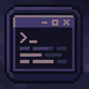

# GreetConsole 1.0.0 — Minecraft 1.21.8 (Fabric)

GreetConsole opens a separate Windows desktop window for the live Minecraft client log. It reads the active `logs/latest.log` file from the current Minecraft game directory, including custom launcher game directories.

## Features

- Press **F8** in Minecraft to show or hide the separate desktop window.
- Reads existing log history, then follows new lines without blocking the game thread.
- Retains the latest 5,000 lines in memory.
- Filters: TRACE, DEBUG, INFO, WARN, ERROR, FATAL and OTHER.
- Search, pause/resume, clear, copy and auto-scroll.
- UTF-8 / Unicode text, Cyrillic, Latin, symbols and emoji using system fallback fonts.
- Color formats:
  - Legacy Minecraft `&0`–`&f` and `§0`–`§f`.
  - Styles: `&l`, `&o`, `&n`, `&m`, `&r`.
  - HEX: `&#RRGGBB`.
  - Repeated HEX: `&x&F&F&5&5&0&0` / `§x§F§F§5§5§0§0`.
  - ANSI SGR, including 24-bit RGB and 256-color sequences.

The original Minecraft log file is never modified. `&k` is accepted as a formatting marker, but obfuscation is intentionally not applied so log text stays readable.

## Requirements

- Minecraft Java Edition **1.21.8**.
- Java **21**.
- Fabric Loader.
- Fabric API for Minecraft 1.21.8.

Resources:
- [Fabric Loader installer](https://fabricmc.net/use/installer/)
- [Fabric API for Minecraft 1.21.8](https://modrinth.com/mod/fabric-api/versions?g=1.21.8&l=fabric)
- [Java 21 — Eclipse Temurin](https://adoptium.net/temurin/releases/?version=21)
- [Fabric mod installation guide](https://docs.fabricmc.net/players/installing-mods)

## Installation

1. Install Fabric Loader for Minecraft 1.21.8.
2. Put the GreetConsole JAR and Fabric API JAR into `.minecraft/mods` (or the `mods` folder of the active game directory).
3. Launch the Fabric 1.21.8 profile.
4. Press **F8** to open the separate log window.

Closing the window with its X button hides it; it does not stop log capture. The background reader stops when Minecraft exits.

## Build from source (Windows)

Run `build.bat`. It downloads Gradle 8.14.3 into `%LOCALAPPDATA%\\GreetConsole` on first run, then builds the mod. The remapped JAR is written to `build\\libs\\greetconsole-1.0.0.jar`.

The desktop-window Java source is stored as a gzip-compressed text file in the repository and is restored automatically by Gradle before compilation. This does not affect the resulting JAR.

GitHub Actions builds the mod on every push to `main` and uploads the remapped JAR as a workflow artifact. Tags named `v*` publish GitHub Releases.

## License

MIT.
